<div align="center">

# 🎬 GTA6 Viral Clipper Pro

**Automated Livestream & YouTube-to-Shorts Content Factory**

Turn live gaming broadcasts and YouTube VODs into ready-to-publish **9:16 vertical Shorts & Reels (>30s)** with Gemini multimodal highlight detection, Whisper subtitles, burned hook banners, dual thumbnails, SEO metadata, and 1-click uploading.

[](https://www.python.org/)
[](https://streamlit.io/)
[](https://aistudio.google.com/)
[](https://github.com/Raghunath2604/GTA6_CLIPPER/actions/workflows/ci.yml)
[](LICENSE)

</div>

---

## 🎥 Demo Showcase

<p align="center">
  <a href="assets/gta6_clipper_demo.mp4">
    
  </a>
</p>

<p align="center">
  <a href="assets/gta6_clipper_demo.mp4"><strong>▶️ Watch Full 1080p Demo Video (MP4 with Audio)</strong></a>
</p>

---

## ⚙️ How It Works

```mermaid
flowchart LR
    A["YouTube URL or Live Stream"] --> B["yt-dlp + FFmpeg Buffer (Muxed Audio + Video)"]
    B --> C["Chat Velocity Analyzer (10s Burst Spikes)"]
    C --> D["Gemini Multimodal AI (Pydantic Viral Extraction)"]
    D --> E["faster-whisper Slice Audio (16 kHz WAV -> SRT)"]
    E --> F["FFmpeg Single-Pass 1080x1920 Render (Hook + ASS Subs)"]
    F --> G["Packager (MP4, Dual Thumbnails, SEO Metadata)"]
    G --> H["YouTube Shorts Drafts & Instagram Reels"]
```



---

## ✨ Key Features

| Capability | Details |
| :--- | :--- |
| **Dual Stream & URL Ingestion** | Supports direct YouTube video/live links and channel `/streams` or `/videos` monitoring with fallback tab resolution and muxed live HLS audio+video capture. |
| **Chat Spike + AI Highlight Engine** | Detects 10-second live chat velocity bursts and passes hotspots alongside video to **Google Gemini** (`gemini-3.8-flash` → `gemini-3-flash-preview` → `gemini-flash-latest`) with Pydantic structured schemas. |
| **Strict >30s Vertical Format** | Cuts configurable `30s–60s` clips (default `35s`) starting 5–8s before climax buildup, cropped cleanly to `1080x1920` (`9:16` @ `30 fps`). |
| **Accurate Audio-Synced Subtitles** | Slices per-clip audio with FFmpeg to 16 kHz mono WAV and transcribes locally via `faster-whisper`, rendered in crisp `1080x1920` ASS yellow-and-black lower-third captions (`MarginV=320`). |
| **Hook Banners & Dual Thumbnails** | Burns bold ALL-CAPS hook banners and exports both `thumbnail_{i}_clean.jpg` (text-free frame for Canva) and `thumbnail_{i}.jpg` (ready-to-post with banner). |
| **1-Click Social Publishing** | Uploads directly to **YouTube Shorts** (`private`, `unlisted`, or `public` with Category 20 Gaming + `#Shorts` + custom thumbnail), **Instagram Reels** (Direct Login or Meta Graph API permalink), and clean frame asset uploads to **Canva Connect**. |
| **Live Streamlit Control Center** | Thread-safe worker monitor with auto-refreshing gallery, real-time YouTube/Instagram/Canva OAuth health checks, clip search/score filters, subtitle previewer, editable tags/SEO editor, and deduplication history (`processed_videos.txt`). |

---

## 📺 Default Monitored Creators

Pre-configured in [config.example.json](config.example.json) and [config.py](config.py) (editable in the dashboard):

* **IShowSpeed** (`https://www.youtube.com/@IShowSpeed/streams`)
* **TGG** (`https://www.youtube.com/@TGGOfficial/videos`)
* **DarkViperAU** (`https://www.youtube.com/@DarkViperAU/streams`)
* **Nought** (`https://www.youtube.com/@NoughtPointFourLIVE/streams`)
* **Mythpat** (`https://www.youtube.com/@Mythpat/streams`)

---

## 🚀 Quick Start

### 1. Prerequisites
* **Python 3.10+** (verified on Python 3.12)
* **FFmpeg & FFprobe** installed (on Windows: `winget install Gyan.FFmpeg` — auto-discovered by [ffmpeg_utils.py](ffmpeg_utils.py))

### 2. Installation
```powershell
git clone https://github.com/Raghunath2604/GTA6_CLIPPER.git
cd GTA6_CLIPPER
python -m pip install -r requirements.txt
```

### 3. Configure Environment
Copy `.env.example` to `.env` and add your keys:
```powershell
Copy-Item .env.example .env
```
Optionally copy `config.example.json` to `config.json` for customized streamer lists and capture defaults.

### 4. Authenticate Platforms
Run the interactive authentication CLI (or double-click `Login_CLI.bat`):
```powershell
python login_cli.py --service all
```
* **YouTube Shorts:** Place `client_secret.json` in the project root (or enter Client ID/Secret when prompted) to generate `token.json`.
* **Instagram Reels:** Connect via **Direct Login** (`INSTAGRAM_USERNAME` / `INSTAGRAM_PASSWORD`, stored in `ig_session.json`) or **Meta Graph API** (`INSTAGRAM_ACCESS_TOKEN` / `INSTAGRAM_ACCOUNT_ID`). You can also sign in directly from the Streamlit sidebar.
* **Canva Pro (Optional):** Connect Canva Connect OAuth credentials for template workflows.

### 5. Launch the Dashboard or CLI
**Web Dashboard** (or double-click `Start_Clipper.bat`):
```powershell
streamlit run app.py --server.port 8501
```
Then open `http://localhost:8501`.

**Single-Video CLI Runner:**
```powershell
python run_real_clip.py "https://www.youtube.com/watch?v=VIDEO_ID" --clips 2 --duration 35 --upload-yt --privacy private
```

---

## 📁 Project Structure

```text
GTA6_CLIPPER/
├── app.py                     # Streamlit control dashboard & 1-click publishers
├── pipeline.py                # Multi-threaded channel orchestrator
├── stream_manager.py          # yt-dlp VOD/channel discovery & muxed live buffer capture
├── chat_analyzer.py           # 10s interval live chat burst velocity scoring
├── ai_clipper.py              # Google Gemini multimodal highlight extraction (Pydantic)
├── subtitle_generator.py      # Slice-synced FFmpeg WAV + faster-whisper SRT generator
├── video_editor.py            # Single-pass 9:16 encoder, hook banners & 1080x1920 ASS burn
├── media_packager.py          # Asset organizer for MP4, dual thumbnails & SEO metadata
├── youtube_uploader.py        # YouTube Data API v3 Shorts draft + thumbnail uploader
├── instagram_uploader.py      # Instagram Reels (instagrapi + Meta Graph resumable upload)
├── canva_connector.py         # Canva Connect API OAuth asset uploader for clean thumbnails
├── login_cli.py               # Unified OAuth & account login CLI
├── run_real_clip.py           # CLI pipeline runner with --clips/--duration/--upload-yt flags
├── config.py                  # Config priority manager (config.json > .env > defaults)
├── ffmpeg_utils.py            # Cross-path FFmpeg/FFprobe & GPU encoder auto-detection
├── logger.py                  # Thread-safe rotating file & console logger (logs/clipper.log)
├── processed_tracker.py       # Idempotent thread-safe video deduplication registry
├── tests/test_core.py         # Automated unit tests
├── .github/workflows/ci.yml   # GitHub Actions CI verification
├── .env.example               # Environment configuration template
└── config.example.json        # Creator & clipping defaults template
```

### Generated Clip Package (`Output_Clips/<VideoID>_Clip<N>_<Title>/`)
```text
├── clip_1.mp4                 # 1080x1920 Vertical Short (>30s) with hook banner & ASS subs
├── clip_1.srt                 # Synced SRT transcript cues
├── thumbnail_1_clean.jpg      # Clean 9:16 gameplay frame for Canva Pro templates
├── thumbnail_1.jpg            # Ready-to-post thumbnail with hook banner overlay
├── SEO_metadata.txt           # Ready-to-copy title, caption, hashtags & tags
└── metadata.json              # Machine-readable metadata for dashboard & uploaders
```

---

## 🧪 Running Tests

```powershell
python -m unittest discover -s tests -v
```

---

## 📄 License

This project is licensed under the MIT License — see [LICENSE](LICENSE) for details.
